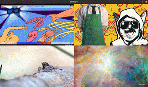
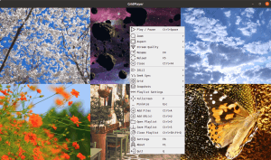
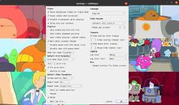
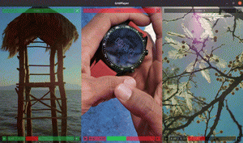

[](https://github.com/vegness/gridplayer-extended/releases/latest)

> **This is a modified fork of [GridPlayer](https://github.com/vzhd1701/gridplayer)** by
> [vzhd1701](https://github.com/vzhd1701), released under the same GNU GPL v3 license.
> It is an unofficial build and is **not** endorsed by, affiliated with, or maintained by the
> original author. Bug reports and feature requests about the changes below belong in
> [this fork's issue tracker](https://github.com/vegness/gridplayer-extended/issues), not upstream.
>
> **Upstream is the place for the full, stable, cross-platform product.**
> Most install methods described below (Flathub, Snap, AppImage, DMG, PyPI, Scoop) still
> point at upstream releases and serve the *original* GridPlayer, not this fork.

## What this fork adds

Everything upstream has, plus:

- **Draggable cell dividers** — drag the split lines between cells to give one video more
  room than the others, in the style of a tiling window manager. Double-click a divider to
  snap the row back to even. The proportions are saved with the playlist.
- **Floating mini window** — pull one video out into a small always-on-top window of its
  own, resizable and movable, while the remaining videos re-tile into the space it left.
  Toggle with `Ctrl+D`; the choice is saved with the playlist.

## Screenshots

[](resources/public/screenshot-001.png)
[](resources/public/screenshot-002.png)
[](resources/public/screenshot-003.png)
[](resources/public/screenshot-004.png)

## About

Simple VLC-based media player that can play multiple videos at the same time. You can
play as many videos as you like, the only limit is your hardware. It supports all video
formats that VLC supports (which is all of them). You can save your playlist retaining
information about the position, sound volume, loops, aspect ratio, etc.

## Features

- **Draggable cell dividers** and a **floating mini window** (see above — this fork only)
- Cross-platform (Linux, Mac, and Windows)
- Support for any video and audio format (VLC)
- Support for (almost) any streaming
  URLs ([streamlink](https://streamlink.github.io/plugins.html) + [yt-dlp](https://github.com/yt-dlp/yt-dlp/blob/master/supportedsites.md))
- Play a whole list in one cell: m3u, pls and xspf playlists, folders, YouTube playlists, IPTV channels
- Cookie support for streams that need a login
- Skip sponsors and other marked parts of YouTube videos with [SponsorBlock](https://sponsor.ajay.app/)
- Hardware & software video decoding
- Control video aspect, playback speed, zoom
- Set loop fragments with frame precision
- Configurable grid layout
- Easy swap videos with drag-n-drop
- Playlist retains settings for each video

## Translation

Translations are managed upstream on [Crowdin](https://crowdin.com/project/gridplayer) and
carried over here as-is. If you want to improve a translation, contributing there is the
way to do it — the strings are the same, and the work benefits both projects.

Huge thanks to [every upstream contributor](https://github.com/vzhd1701/gridplayer#translations)!

## Installation

### Windows

This fork is built for Windows only. Grab the latest build from
[Releases](https://github.com/vegness/gridplayer-extended/releases/latest):

[](https://github.com/vegness/gridplayer-extended/releases/latest)
[](https://github.com/vegness/gridplayer-extended/releases/latest)

- **Installer** — per-user by default, so no administrator rights and no UAC prompt. The
  wizard asks where to put it; anything you pick works. It also cleans up a previous
  install's runtime files in the target folder before unpacking, because mixing two
  PyInstaller runtimes in one directory stops the program from starting at all.
- **Portable** — unzip anywhere and run `GridPlayer.exe`. Drop a `portable_data` folder
  beside it and the whole install stays self-contained.

Both come with VLC bundled, so nothing else needs installing. **Compatible with Windows
10 and 11 (64-bit).**

### Other platforms

Linux, macOS and the `uv`/`pip` routes below are still upstream's, and building this fork
from source on them is untested. For those, use
[the original](https://github.com/vzhd1701/gridplayer) — it has the same features minus
the two this fork adds.

### Linux (upstream)

[](https://flathub.org/apps/details/com.vzhd1701.gridplayer)
[](https://snapcraft.io/gridplayer)
[](https://github.com/vzhd1701/gridplayer/releases/latest)

**For better system integration install via Flathub.**

#### Note on AppImage

The AppImage is built on `manylinux_2_28` (glibc 2.28), so it runs on Ubuntu 20.04+, Debian 10+, Fedora 29+,
RHEL / AlmaLinux / Rocky 8+ and other distros of the same age or newer.

You may need to set execute permissions on AppImage file in order to run it:

```shell
chmod +x GridPlayer-0.5.5-x86_64.AppImage
```

### MacOS (upstream)

[](https://github.com/vzhd1701/gridplayer/releases/latest)

**DMG image is not signed and targets Apple Silicon (`arm64`).** You will have to add an exception to run this app.

- [How to open an app that hasn’t been notarized or is from an unidentified developer](https://support.apple.com/en-euro/HT202491)
- [Open a Mac app from an unidentified developer](https://support.apple.com/guide/mac-help/open-a-mac-app-from-an-unidentified-developer-mh40616/mac)

If you get "GridPlayer is damaged and can't be opened" error, run this command in the Terminal app:

```shell
sudo xattr -rd com.apple.quarantine /Applications/GridPlayer.app
```

### Install with [UV](https://docs.astral.sh/uv/) (upstream package)

```shell
uv tool install gridplayer
```

**Python 3.10 or later required.**

This type of installation will also require VLC installed (Windows & Mac) or a `vlc` package (Linux) present in your
system.
Please refer to [VLC official page](https://www.videolan.org/vlc/) for instructions on how to install it.

Some distros (e.g. Ubuntu) might also require `libxcb-xinerama0` package.

### From source

```shell
git clone https://github.com/vegness/gridplayer-extended.git
cd gridplayer-extended
uv sync
uv run gridplayer
```

The same notes about the Python version and external packages from above apply here.

## Command line options

```shell
gridplayer [options] [FILE|URL ...]
```

Any arguments that are not options are treated as media files, folders, `.gpls` playlists, media lists (`.m3u`,
`.m3u8`, `.pls`, `.xspf`), or streaming URLs (`https://`, `rtsp://`, ...) to open on startup. A folder or a media list
plays in one cell, one file after another. Unrecognized options are rejected with an error; use `--` to open
dash-prefixed filenames.

| Option                | Description                                                                                                            |
| --------------------- | ---------------------------------------------------------------------------------------------------------------------- |
| `--user-data-dir PATH` | Store settings and log files in `PATH` instead of the default location. Relative paths are resolved against the current working directory. |
| `--platform {auto,xcb,wayland}` | Linux only. Display server to run on. `auto` picks `xcb` (X11 or Xwayland) when there is one, `wayland` otherwise. Hardware video needs `xcb`. |
| `--version`           | Show the application version and exit.                                                                                 |
| `--help`              | Show the available options and exit.                                                                                   |

### User data directory

By default, settings and logs are stored in the system application data directory (see below). On the Windows portable
build, if a `portable_data` folder exists next to the executable, it is used automatically.

You can point GridPlayer at any directory for its data:

```shell
# via command line option
gridplayer --user-data-dir ./my_data

# via environment variable
export GP_USER_DATA_DIR=/path/to/my_data
gridplayer
```

The command line option takes precedence over the environment variable. Setting either one on all platforms and
installation types stores data in the given directory instead of the standard system location.

### Default data directory locations

Without a custom user data directory, settings (`settings.ini`) and log (`gridplayer.log`) files are stored in the
standard application data location:

| Platform | Location                                              |
| -------- | ----------------------------------------------------- |
| Windows  | `C:\Users\<USER>\AppData\Roaming\vzhd1701\GridPlayer` |
| Linux    | `~/.local/share/vzhd1701/GridPlayer`                  |
| macOS    | `~/Library/Application Support/vzhd1701/GridPlayer`   |

**Settings -> Open data folder** opens this directory, whichever package you are running.

The `vzhd1701` in these paths is the application ID inherited from upstream. It is left
as it is on purpose: changing it would move the settings folder and start this fork with
an empty configuration.

On Linux, `XDG_DATA_HOME` is respected instead of `~/.local/share` when set. Sandboxed packages store the directory
inside their own sandbox: `~/.var/app/com.vzhd1701.gridplayer/data/vzhd1701/GridPlayer` for Flatpak, and
`~/snap/gridplayer/current/.local/share/vzhd1701/GridPlayer` for Snap.

## Video Decoder settings

GridPlayer supports two video output modes:

- Hardware (default) mode uses available GPU to render video. This mode offers high performance and is a recommended
  mode.
- Software mode is entirely independent of GPU and only uses the CPU to render video. This mode may cause a high CPU
  load with high-resolution videos.

Due to libvlc software library limitations, video decoding is split into parallel processes. You can control how many
videos are handled by a single decoder process using the "Videos per process" setting. Setting this option too high may
cause a high CPU load and application freeze. The optimal value is 4 videos per process.

There are also single-process ("SP") modes. "Hardware SP" and "Software SP" handle video decoding within the same
process in which GridPlayer runs. They are not recommended to use with many videos (>4-6) because they may cause high
CPU load and application freeze.

Due to OS inter-process restrictions, "Hardware SP" is the only available hardware mode in macOS.

## Streaming cookies

Some links won't resolve without a login, especially YouTube with it's *"Sign in to confirm you're not a
bot"*. GridPlayer can store cookies and pass them to both yt-dlp and Streamlink.

Go to **Settings -> Streaming -> Cookies** and import a `cookies.txt` file, or paste one from the clipboard.

### Exporting cookies from your browser

Export from a private window, and close it when you're done:

1. Open a private browsing window and log in to your site (youtube in this example).
2. In the same tab, go to `https://www.youtube.com/robots.txt` (any static page on the site).
3. Export/copy cookies for the site with a browser extension ([FF](https://addons.mozilla.org/en-US/firefox/addon/cookies-txt/), [Chrome](https://chrome.google.com/webstore/detail/get-cookiestxt-locally/cclelndahbckbenkjhflpdbgdldlbecc)).
4. Close the window **without logging out**. Logging out kills the session you just exported.
5. Import the `cookies.txt` file into GridPlayer, or paste it.

YouTube rotates cookies on open tabs. If you export from your normal session it will go stale within hours.
A private window you never reopen has nothing left to rotate them. For the same reason, don't use one
export in two places at once.

More detail in the [yt-dlp FAQ](https://github.com/yt-dlp/yt-dlp/wiki/FAQ#how-do-i-pass-cookies-to-yt-dlp).

### Where cookies are stored

`cookies.txt` in the [user data directory](#default-data-directory-locations), in the standard Netscape format.

The file isn't encrypted, so treat it like a password. Import only the domains you need, and clear the store when
you're done with them.

## Network settings

A proxy, an address family and a user agent shared by everything GridPlayer fetches with: yt-dlp,
Streamlink and the player itself.

Go to **Settings -> Streaming -> Network**.

| Setting | What it does |
| --- | --- |
| **Proxy** | `System` follows the machine's own proxy settings. `None` connects directly, ignoring them. `Custom` takes an address of your own. |
| **Proxy address** | `http://host:port`, or `socks5h://host:port` to resolve names at the proxy rather than locally. |
| **Request timeout** | How long to wait on a request before giving up. Applies while a link is being resolved, not while it is playing. `Auto` leaves each tool on its own default, which is 20 seconds for both. |
| **User agent** | How the player identifies itself. `Auto` leaves each tool on its own. A link that came with a user agent of its own keeps it. |
| **Force IPv4** | Skip IPv6. Fixes a connection that stalls on IPv6 that is offered but does not work, and sites that turn away your IPv6 address. |
| **Verify TLS certificates** | Turn off only for a proxy that signs traffic with its own certificate. |

### What these apply to

**http and https links only**, apart from the user agent.

The player has no proxy setting it honours everywhere, no way to be held to one address family, and no
way to be told whose certificates to trust. So when any of those is set, links stop being handed to the
player and are fetched by GridPlayer instead, then served to the player from `127.0.0.1`.

Links of other kinds — `rtsp`, `rtmp` and so on — are opened by the player itself and go out directly.
Only the user agent reaches those. If you need those proxied too, proxy the whole machine.

## JavaScript runtime

YouTube scrambles its stream addresses with a script that has to be run to undo. GridPlayer doesn't ship
an engine to run it with, so if YouTube links stop playing, install one of these and restart:

| Engine | Size | Speed | |
| --- | --- | --- | --- |
| **[Deno](https://docs.deno.com/runtime/getting_started/installation/)** | ~110 MB | fastest | Recommended. Sandboxed by default. |
| **[Node](https://nodejs.org/)** | ~80 MB | fastest | Version 22 or newer. Just as good, and you may have it already. |
| **[QuickJS](https://github.com/quickjs-ng/quickjs/releases)** (`qjs`) | ~2 MB | ~7x slower | Tiny, but adds a few seconds to every YouTube link. |
| **[Bun](https://bun.sh/)** | ~90 MB | fast | Version 1.2.11 or newer. |

Any one of them is enough, and GridPlayer uses the best one it finds. It looks in these places, in order:

1. The folder named in **Settings -> Streaming -> Link Resolution -> JavaScript runtime**, if you set one.
2. The GridPlayer [data directory](#default-data-directory-locations) — drop the binary in next to
   `settings.ini`. The **Open data folder** button at the bottom of the settings window takes you there.
3. The usual install locations: your `PATH`, `~/.deno/bin` and `~/.bun/bin`, and on macOS the Homebrew
   folders (`/opt/homebrew/bin`, `/usr/local/bin`).

Installing an engine the ordinary way is normally all it takes. Two cases need a hand:

- **Snap** can't see anything outside itself, and hidden folders like `~/.deno` are blocked, so put the
  binary in the data folder.
- **Node managed by nvm** lives in a folder per version, which nothing can guess. Name it in the settings.

**Settings -> Streaming -> Link Resolution -> Test a YouTube link** names the one that will actually be used and where it is, since only one of several installed ever runs.

Not every link needs one. YouTube often hands out addresses that need no unscrambling at all, and nothing
else GridPlayer plays uses this. It's worth installing when YouTube specifically starts failing.

## Known issues

### Linux (Snap): Error when opening a file from the mounted disk

You need to allow GridPlayer snap to access removable storage devices via Snap Store or by running:

```shell
sudo snap connect gridplayer:removable-media
```

### Linux (Snap): mounted drives are not visible in file selection dialog

You will also see following error if you run GridPlayer from terminal:

```shell
GLib-GIO-WARNING **: Error creating IO channel for /proc/self/mountinfo: Permission denied (g-file-error-quark, 2)
```

To fix this, you need to allow GridPlayer snap to access system mount information and disk quotas via Snap Store or by
running:

```shell
sudo snap connect gridplayer:mount-observe
```

### Linux: black screen issue when using hardware decoder

If no compositor is running, GridPlayer switches the overlay to opaque automatically. If the overlay is still a black
screen, switch on "Opaque overlay (fix black screen)" checkbox in settings.

Depending on the window manager, the overlay might be a bit glitchy with the hardware decoder. Enabling compositor might
help.

## Getting help

If you found a bug or have a feature request **about this fork** — the draggable dividers,
the mini window, the Windows build — please
[open an issue here](https://github.com/vegness/gridplayer-extended/issues).

Anything that also happens with the original GridPlayer, and every question about the
program itself, is [upstream's to answer](https://github.com/vzhd1701/gridplayer/issues).
Filing those here only delays a fix, because the person who wrote the code is not in this
repository.

## Attributions

This software was build using

- **Python** by [Python Software Foundation](https://www.python.org/)
  - Licensed under *Python Software Foundation License*
- **Qt** by [Qt Project](https://www.qt.io/)
  - Licensed under *GPL 2.0, GPL 3.0, and LGPL 3.0*
- **VLC** by [VideoLAN](https://www.videolan.org/)
  - Licensed under *GPL 2.0 or later*

### Python packages

- **PyQt** by [Riverbank Computing](https://riverbankcomputing.com/)
  - Licensed under *Riverbank Commercial License and GPL v3*
- **python-vlc** by [Olivier Aubert](https://github.com/oaubert/python-vlc)
  - Licensed under *GPL 2.0 and LGPL 2.1*
- **pydantic** by [Samuel Colvin](https://github.com/samuelcolvin/pydantic)
  - Licensed under *MIT License*
- **streamlink** by [Christopher Rosell, Streamlink Team](https://github.com/streamlink/streamlink)
  - Licensed under *BSD-2-Clause License*
- **yt-dlp** by [Contributors](https://github.com/yt-dlp/yt-dlp)
  - Licensed under *Unlicense License*

### Graphics

- **Hack Font** by [Source Foundry](http://sourcefoundry.org/hack/)
  - Licensed under *MIT License*
- **Basic Icons** by [Icongeek26](https://www.flaticon.com/authors/icongeek26)
  - Licensed under *Flaticon License*
- **Suru Icons** by [Sam Hewitt](https://snwh.org/)
  - Licensed under *Creative Commons Attribution-Share Alike 4.0*
- **Clean App Download Buttons** by [Tony Thomas](https://medialoot.com/item/clean-app-download-buttons/)
  - Licensed under *MediaLoot License*
- **Flag Icons** by [Panayiotis Lipiridis](https://github.com/lipis/flag-icons)
  - Licensed under *MIT License*

### Data

- **SponsorBlock** by [Ajay Ramachandran and contributors](https://sponsor.ajay.app/)
  - Licensed under *CC BY-NC-SA 4.0*

## Translations

<!-- CROWDIN-CONTRIBUTORS-START -->

<table>
  <tbody>
    <tr>
      <td align="center" valign="top">
        <a href="https://crowdin.com/profile/VenusGirl">
          <br />
          <sub><b>VenusGirl</b></sub></a>
        <br />
        <sub><b>886 words</b></sub>
        <br /><sub><b><code title="Korean">ko</code></b></sub>
      </td>
      <td align="center" valign="top">
        <a href="https://crowdin.com/profile/LOUIS_Sylvain">
          <br />
          <sub><b>Sylvain LOUIS</b></sub>
          <br />
          <sub><b>(LOUIS_Sylvain)</b></sub></a>
        <br />
        <sub><b>886 words</b></sub>
        <br /><sub><b><code title="French">fr</code></b></sub>
      </td>
      <td align="center" valign="top">
        <a href="https://crowdin.com/profile/Gabriel-BS1">
          <br />
          <sub><b>GBS ~ TECH</b></sub>
          <br />
          <sub><b>(Gabriel-BS1)</b></sub></a>
        <br />
        <sub><b>886 words</b></sub>
        <br /><sub><b><code title="Portuguese, Brazilian">pt-BR</code></b></sub>
      </td>
      <td align="center" valign="top">
        <a href="https://crowdin.com/profile/Granberg">
          <br />
          <sub><b>Göran</b></sub>
          <br />
          <sub><b>(Granberg)</b></sub></a>
        <br />
        <sub><b>875 words</b></sub>
        <br /><sub><b><code title="Swedish">sv-SE</code></b></sub>
      </td>
      <td align="center" valign="top">
        <a href="https://crowdin.com/profile/royhendum">
          <br />
          <sub><b>Roy Hendum</b></sub>
          <br />
          <sub><b>(royhendum)</b></sub></a>
        <br />
        <sub><b>875 words</b></sub>
        <br /><sub><b><code title="Norwegian">no</code></b></sub>
      </td>
      <td align="center" valign="top">
        <a href="https://crowdin.com/profile/zxas">
          <br />
          <sub><b>z Z</b></sub>
          <br />
          <sub><b>(zxas)</b></sub></a>
        <br />
        <sub><b>851 words</b></sub>
        <br /><sub><b><code title="Chinese Traditional">zh-TW</code></b></sub>
      </td>
    </tr>
    <tr>
      <td align="center" valign="top">
        <a href="https://crowdin.com/profile/davidev1">
          <br />
          <sub><b>Davide V.</b></sub>
          <br />
          <sub><b>(davidev1)</b></sub></a>
        <br />
        <sub><b>752 words</b></sub>
        <br /><sub><b><code title="Italian">it</code></b></sub>
      </td>
      <td align="center" valign="top">
        <a href="https://crowdin.com/profile/Vistaus">
          <br />
          <sub><b>Heimen Stoffels</b></sub>
          <br />
          <sub><b>(Vistaus)</b></sub></a>
        <br />
        <sub><b>751 words</b></sub>
        <br /><sub><b><code title="Dutch">nl</code></b></sub>
      </td>
      <td align="center" valign="top">
        <a href="https://crowdin.com/profile/japanese.john.doe.774">
          <br />
          <sub><b>七篠孝志</b></sub>
          <br />
          <sub><b>(japanese.john.doe.774)</b></sub></a>
        <br />
        <sub><b>751 words</b></sub>
        <br /><sub><b><code title="Japanese">ja</code></b></sub>
      </td>
      <td align="center" valign="top">
        <a href="https://crowdin.com/profile/DominikPott">
          <br />
          <sub><b>DominikPott</b></sub></a>
        <br />
        <sub><b>751 words</b></sub>
        <br /><sub><b><code title="German">de</code></b></sub>
      </td>
      <td align="center" valign="top">
        <a href="https://crowdin.com/profile/Azoaz6001">
          <br />
          <sub><b>Azoaz6001</b></sub></a>
        <br />
        <sub><b>751 words</b></sub>
        <br /><sub><b><code title="Arabic">ar</code></b></sub>
      </td>
      <td align="center" valign="top">
        <a href="https://crowdin.com/profile/wyg945">
          <br />
          <sub><b>Yagang Wang</b></sub>
          <br />
          <sub><b>(wyg945)</b></sub></a>
        <br />
        <sub><b>751 words</b></sub>
        <br /><sub><b><code title="Chinese Simplified">zh-CN</code></b></sub>
      </td>
    </tr>
    <tr>
      <td align="center" valign="top">
        <a href="https://crowdin.com/profile/Golbinex">
          <br />
          <sub><b>Kryštof Baksa</b></sub>
          <br />
          <sub><b>(Golbinex)</b></sub></a>
        <br />
        <sub><b>674 words</b></sub>
        <br /><sub><b><code title="Czech">cs</code></b></sub>
      </td>
      <td align="center" valign="top">
        <a href="https://crowdin.com/profile/IngrownMink4">
          <br />
          <sub><b>Sergio Varela</b></sub>
          <br />
          <sub><b>(IngrownMink4)</b></sub></a>
        <br />
        <sub><b>652 words</b></sub>
        <br /><sub><b><code title="Spanish">es-ES</code></b></sub>
      </td>
      <td align="center" valign="top">
        <a href="https://crowdin.com/profile/fifi132">
          <br />
          <sub><b>rafal132</b></sub>
          <br />
          <sub><b>(fifi132)</b></sub></a>
        <br />
        <sub><b>598 words</b></sub>
        <br /><sub><b><code title="Polish">pl</code></b></sub>
      </td>
      <td align="center" valign="top">
        <a href="https://crowdin.com/profile/a2942">
          <br />
          <sub><b>a2942</b></sub></a>
        <br />
        <sub><b>496 words</b></sub>
        <br /><sub><b><code title="Chinese Simplified">zh-CN</code></b></sub>
      </td>
      <td align="center" valign="top">
        <a href="https://crowdin.com/profile/LiberiFatali">
          <br />
          <sub><b>LiberiFatali</b></sub></a>
        <br />
        <sub><b>456 words</b></sub>
        <br /><sub><b><code title="Vietnamese">vi</code></b></sub>
      </td>
      <td align="center" valign="top">
        <a href="https://crowdin.com/profile/samu112">
          <br />
          <sub><b>samu112</b></sub></a>
        <br />
        <sub><b>438 words</b></sub>
        <br /><sub><b><code title="Hungarian">hu</code></b></sub>
      </td>
    </tr>
    <tr>
      <td align="center" valign="top">
        <a href="https://crowdin.com/profile/asolis2020">
          <br />
          <sub><b>asolis2020</b></sub></a>
        <br />
        <sub><b>266 words</b></sub>
        <br /><sub><b><code title="Spanish">es-ES</code></b></sub>
      </td>
      <td align="center" valign="top">
        <a href="https://crowdin.com/profile/SolarCTP">
          <br />
          <sub><b>SolarCTP</b></sub></a>
        <br />
        <sub><b>164 words</b></sub>
        <br /><sub><b><code title="Italian">it</code></b></sub>
      </td>
      <td align="center" valign="top">
        <a href="https://crowdin.com/profile/PrinceNorris">
          <br />
          <sub><b>Sebastian Jasiński</b></sub>
          <br />
          <sub><b>(PrinceNorris)</b></sub></a>
        <br />
        <sub><b>163 words</b></sub>
        <br /><sub><b><code title="Polish">pl</code></b></sub>
      </td>
      <td align="center" valign="top">
        <a href="https://crowdin.com/profile/reiss404">
          <br />
          <sub><b>Manuel</b></sub>
          <br />
          <sub><b>(reiss404)</b></sub></a>
        <br />
        <sub><b>133 words</b></sub>
        <br /><sub><b><code title="German">de</code></b></sub>
      </td>
      <td align="center" valign="top">
        <a href="https://crowdin.com/profile/aportuguesecoder">
          <br />
          <sub><b>Armando Gomes</b></sub>
          <br />
          <sub><b>(aportuguesecoder)</b></sub></a>
        <br />
        <sub><b>121 words</b></sub>
        <br /><sub><b><code title="Portuguese">pt-PT</code></b></sub>
      </td>
      <td align="center" valign="top">
        <a href="https://crowdin.com/profile/Akronos">
          <br />
          <sub><b>Akronos</b></sub></a>
        <br />
        <sub><b>112 words</b></sub>
        <br /><sub><b><code title="Czech">cs</code></b></sub>
      </td>
    </tr>
    <tr>
      <td align="center" valign="top">
        <a href="https://crowdin.com/profile/WackyFox">
          <br />
          <sub><b>Владимир Ларин</b></sub>
          <br />
          <sub><b>(WackyFox)</b></sub></a>
        <br />
        <sub><b>108 words</b></sub>
        <br /><sub><b><code title="Hebrew">he</code></b></sub>
      </td>
    </tr>
  </tbody>
</table>
<!-- CROWDIN-CONTRIBUTORS-END -->

## License

This fork, like the original GridPlayer it is built from, is licensed under the
**GNU General Public License version 3 (GPLv3)**. Full text of the license is available
in the [LICENSE](LICENSE) file in this repository and
[online](https://www.gnu.org/licenses/gpl-3.0.html).

Original work copyright © [vzhd1701](https://github.com/vzhd1701).
Modifications in this fork copyright © [vegness](https://github.com/vegness).

Under the GPL you are free to use, study, share and modify this software. If you
distribute it or a modified version of it, you must pass on the same freedoms — ship the
source, keep this license and these notices, and state what you changed. Using the name
"GridPlayer" or the name of either author to promote a derivative is not permitted
without permission; see section 7 of the license.
